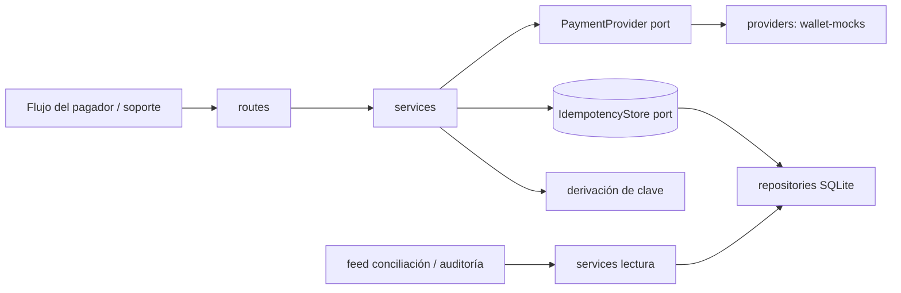

# Impacto de arquitectura: `payment-idempotency-protection` (HU-IDEM, issue #27)

Fecha: 2026-11-06. Rol: Wallet Architect. Estado: **propuesta pendiente de aprobación humana** (alcance, contratos, riesgos y estrategia de pruebas). No se implementa código funcional hasta esa aprobación.

Fuentes: [proposal](../../openspec/changes/payment-idempotency-protection/proposal.md), [design](../../openspec/changes/payment-idempotency-protection/design.md), [spec](../../openspec/changes/payment-idempotency-protection/specs/payment-idempotency/spec.md), [tasks](../../openspec/changes/payment-idempotency-protection/tasks.md), [constitución](../WALLET-CONSTITUTION.md), [OQ](../OPEN-QUESTIONS.md), [trazabilidad](../TRACEABILITY.md), [AGENTS.md](../../AGENTS.md). Evidencias: [docs/evidence/payment-idempotency-protection/](../evidence/payment-idempotency-protection/README.md).

## 1. Hallazgos previos

- `design.md` es explícito: el repo es greenfield y **no elige tecnología ni almacenamiento** (Non-Goal). Por tanto **Python/FastAPI no está exigido por el diseño**; es un **supuesto de esta propuesta** (alineado con `AGENTS.md`, cuyos componentes anteriores eran Python/FastAPI) y requiere aprobación (ver P-1).
- En `feature/hackaton` no existen `api/` ni `web/`. La API vive en una estructura nueva `api/`.
- Los contratos protegidos del principio 18 (`/auth/login`, `/api/tasks`, `/api/summary`, `/api/requirements`) no existen aquí; los endpoints nuevos no deben reutilizar esas rutas.
- Mock `wallet-mocks` (solo lectura, 2026-11-06): `wallet_health` = `ok` (SQLite). Escenarios de pago: `APPROVED`, `REJECTED`, `PENDING`, `DELAYED_APPROVAL`, `TIMEOUT_AFTER_PROCESSING`, `PROVIDER_ERROR`. Destinatarios: `contact-demo`, `merchant-demo`; wallet de fondos: `wallet-demo`. El mock ya tiene su propia idempotencia (`idempotencyKey` igual y contenido igual → 200; contenido distinto → 409; `TIMEOUT_AFTER_PROCESSING` → 504 con el pago ya creado). Esa idempotencia es una **segunda barrera**, no sustituye la de la wallet (principio 12: sin acoplamiento al riel).

## 2. Componentes y capas



| Capa | Responsabilidad | No hace |
|---|---|---|
| `routes` | HTTP, validación de entrada (Pydantic), identidad del pagador, encabezados `X-Request-Id`/`X-Correlation-Id`, mapeo a códigos HTTP | Reglas de idempotencia, SQL |
| `services` | Derivar clave, reservar, decidir original/duplicado, orquestar proveedor, crear reintento vinculado, leer feed | HTTP, SQL, detalles del mock |
| `ports` | Interfaces (`Protocol`) mínimas con motivo real | Implementación |
| `repositories` | SQLite con consultas parametrizadas; reserva atómica | Reglas de negocio |
| `providers` | Adaptador HTTP a `wallet-mocks` tras el puerto de proveedor | Idempotencia propia |

Puertos con motivo real (solo dos): **PaymentProviderPort** (aislar el riel y permitir doble en pruebas unitarias; tarea 2.4) e **IdempotencyStorePort** (aislar atomicidad, retención y auditoría; permite probar concurrencia). El reloj se inyecta como `Callable[[], datetime]`, sin clase ni puerto.

## 3. Árbol de carpetas propuesto

```
api/
  pyproject.toml                     # dependencias (fastapi, uvicorn, httpx, pytest, pytest-cov) y config de cobertura >= 85%
  README.md                          # cómo ejecutar, variables de entorno
  app/
    __init__.py
    main.py                          # crea la app FastAPI y cablea dependencias
    config.py                        # carga settings: ventana de intento, retención por canal, política de clave vencida, URL del mock
    schemas.py                       # modelos Pydantic de entrada/salida (PaymentRequest, PaymentView, RequestRecordView)
    errors.py                        # excepciones de dominio y su mapeo a HTTP
    routes/
      __init__.py
      payments.py                    # POST /payments, GET /payments/{id}, POST /payments/{id}/retries
      idempotency_audit.py           # GET /idempotency/requests (feed de conciliación y auditoría)
    services/
      __init__.py
      idempotency_key.py             # derive_idempotency_key(): función pura (tareas 2.1)
      payment_service.py             # submit_payment(): reserva, original/duplicado, proveedor (2.2, 2.3, 3.1)
      retry_service.py               # create_linked_retry() (2.5)
      request_audit_service.py        # consulta de feed y relación original-duplicado (3.2, 5.1)
    ports/
      __init__.py
      payment_provider.py            # Protocol PaymentProviderPort
      idempotency_store.py           # Protocol IdempotencyStorePort
    repositories/
      __init__.py
      sqlite_store.py                # implementa IdempotencyStorePort con sqlite3 y esquema
    providers/
      __init__.py
      wallet_mock_provider.py        # implementa PaymentProviderPort contra wallet-mocks (httpx)
  tests/
    conftest.py                      # fixtures: store en memoria/archivo temporal, doble de proveedor, cliente de prueba
    unit/
      test_idempotency_key.py        # 2.1
      test_payment_service.py        # 2.2, 2.3, 3.1, 5.1 con doble del puerto
      test_retry_service.py          # 2.5
      test_sqlite_store_concurrency.py # 2.2 (hilos contra archivo SQLite temporal)
      test_retention_config.py       # 4.1, 4.2
      test_request_audit_service.py  # 3.2, 5.1, 5.2
    acceptance/
      conftest.py                    # lee WALLET_MOCK_URL; se omite si no está definida
      test_provider_contract.py      # 2.4 y 6.1 contra wallet-mocks
docs/architecture/payment-idempotency-protection-impact.md   # este documento
docs/evidence/payment-idempotency-protection/README.md       # índice de evidencias
```

## 4. Contratos y firmas (sin implementación)

```python
# services/idempotency_key.py
def derive_idempotency_key(payer_id: str, amount_cents: int, recipient: str,
                           attempt_window_index: int, intent_id: str) -> str: ...
    # SHA-256 hex de una forma canónica con separador y longitud; función pura.
def attempt_window_index(now: datetime, window_seconds: int) -> int: ...

# ports/payment_provider.py
class PaymentProviderPort(Protocol):
    def submit(self, provider_idempotency_key: str, wallet_id: str, recipient: str,
               amount_cents: int, channel: str) -> ProviderResult: ...
    def resolve(self, provider_payment_id: str) -> ProviderResult: ...
# ProviderResult: provider_payment_id | None, status (PENDING|SUCCEEDED|REJECTED|UNCERTAIN)

# ports/idempotency_store.py
class IdempotencyStorePort(Protocol):
    def reserve_attempt(self, attempt: NewAttempt) -> ReserveOutcome: ...   # atómico: CREATED | EXISTS(attempt)
    def update_attempt(self, payment_id: str, status: str, provider_payment_id: str | None) -> None: ...
    def get_attempt(self, payment_id: str) -> Attempt | None: ...
    def get_attempt_by_key(self, idempotency_key: str) -> Attempt | None: ...
    def append_request(self, record: RequestRecord) -> None: ...            # append-only
    def list_requests(self, filters: RequestFilters) -> list[RequestRecord]: ...
    def link_retry(self, retry_payment_id: str, original_payment_id: str) -> None: ...
```

`ReserveOutcome` y las demás son dataclasses en `ports/idempotency_store.py`.

## 5. Endpoints propuestos

Rutas nuevas; no tocan contratos protegidos. La identidad del pagador se toma de la sesión/credencial (principio 17), nunca del cuerpo (P-3).

| Método y ruta | Entrada | Salida |
|---|---|---|
| `POST /payments` | cuerpo: `intent_id`, `amount_cents`, `recipient`, `channel`; encabezados `X-Request-Id`, `X-Correlation-Id` | 202 original creado; 200 duplicado (resultado original o estado actual, `request_type=duplicate`); 422 entrada inválida |
| `GET /payments/{payment_id}` | — | intento con estado, clave, `retry_of` |
| `POST /payments/{payment_id}/retries` | encabezados de correlación | 202 nuevo intento vinculado (nueva clave y referencia); 409 si el original no está fallido/expirado |
| `GET /idempotency/requests` | filtros `idempotency_key`, `correlation_id`, `date_from`, `date_to`, `request_type` | lista con tipo, vínculo al original, `requested_at`, `original_requested_at` |

Estados del intento: `PENDING`, `SUCCEEDED`, `FAILED`, `EXPIRED` (los terminales son los tres últimos; principio 8). La asignación a `EXPIRED` por tiempo máximo pertenece a PAYER (OQ-17); aquí solo se almacena.

## 6. Modelo de datos (SQLite, propuesta)

Tabla `payment_attempts` (una fila por intento; la clave es la reserva):

| Columna | Nota |
|---|---|
| `payment_id` PK | referencia del intento (OQ-04: se asigna al crear) |
| `idempotency_key` UNIQUE NOT NULL | reserva atómica |
| `payer_id`, `amount_cents`, `recipient`, `channel`, `intent_id` | componentes de la clave |
| `attempt_window_index` | componente de la clave |
| `status` | ver sección 5 |
| `provider_payment_id` NULL | se llena tras el proveedor |
| `retry_of_payment_id` NULL FK | vínculo reintento → original (2.5); consultable en ambos sentidos por índice |
| `created_at`, `updated_at` | UTC |

Tabla `payment_requests` (append-only; es a la vez auditoría y fuente de conciliación):

| Columna | Nota |
|---|---|
| `request_id` PK | de `X-Request-Id` (generado si falta) |
| `correlation_id` | de `X-Correlation-Id` (generado si falta) |
| `idempotency_key`, `payment_id` | enlace al original |
| `request_type` | `original` \| `duplicate` |
| `requested_at`, `original_requested_at` | ambas fechas (OQ-14); sin día de reporte asignado |

- Un reintento vinculado se registra como `original` con su propia clave y `retry_of`; nunca como `duplicate`.
- Totales: se calculan sobre `payment_attempts`; las filas `duplicate` no son transacciones (5.2).
- Sin UPDATE/DELETE sobre `payment_requests`. Sin purga (OQ-13 provisional); la configuración queda reservada.

## 7. Concurrencia

1. `reserve_attempt` hace `INSERT` en `payment_attempts` con `UNIQUE(idempotency_key)` en una transacción corta y confirma **antes** de llamar al proveedor. Si hay violación de unicidad, devuelve `EXISTS` con la fila existente; no hay verificar-luego-insertar.
2. El perdedor de la carrera (o la solicitud repetida) no llama al proveedor: devuelve estado actual o terminal y agrega fila `duplicate`.
3. El ganador llama al proveedor con `provider_idempotency_key = idempotency_key`; así, si el proceso cae entre reserva y llamada, el reproceso es seguro por la idempotencia del mock.
4. Resultado original inmutable: `update_attempt` solo avanza desde `PENDING`; no sobrescribe un estado terminal (principio 10).
5. `TIMEOUT_AFTER_PROCESSING` (504): el pago existe en el proveedor; el intento queda `PENDING` y se resuelve con `resolve` o repitiendo `submit` con la misma clave (por verificar en aceptación, R-4).
6. SQLite: `PRAGMA journal_mode=WAL`, `busy_timeout` configurado, una conexión por operación.

## 8. Configuración (provisional, no codificada; variables de entorno con valores por defecto marcados)

| Variable | Valor provisional | Origen |
|---|---|---|
| `IDEM_ATTEMPT_WINDOW_SECONDS` | 300 (propuesta no aprobada) | OQ-12 |
| `IDEM_RETENTION_SECONDS_BY_CHANNEL` | `default=86400` (propuesta no aprobada, por canal) | OQ-11 |
| `IDEM_EXPIRED_KEY_POLICY` | `return_original` (supuesto: la opción más segura frente a doble cobro; no resuelve OQ-11) | OQ-11 |
| `IDEM_AUDIT_RETENTION_SECONDS` | vacío = sin purga | OQ-13 |
| `WALLET_MOCK_URL` | sin valor por defecto; obligatoria para aceptación | contrato del mock |
| `WALLET_ID` | `wallet-demo` | mock |

Ningún valor se hardcodea en servicios; `config.py` los lee y los inyecta.

## 9. Mapeo de tareas a módulos y pruebas

Las pruebas se escriben **antes** (rojo) y la implementación después.

| Tarea | Módulo | Pruebas que la protegen |
|---|---|---|
| 1.1 | `config.py`, doc | `test_retention_config`: valores leídos de entorno; aprobación humana por OQ-11/OQ-12 (no es código) |
| 1.2 / 1.3 / 1.4 | documentos | Sin prueba; notas de acuerdo y verificación de OQ en `implementation-log.md` |
| 2.1 | `services/idempotency_key.py` | `test_idempotency_key`: intento recibe clave; cambio de cualquier componente cambia clave; misma intención repetida = misma clave; mismo pagador/monto/destino con otro `intent_id` = otra clave; ventana configurable |
| 2.2 | `repositories/sqlite_store.py`, `payment_service.py` | `test_sqlite_store_concurrency`: N hilos con la misma clave → 1 fila y 1 llamada al proveedor |
| 2.3 | `payment_service.py` | repetición con resultado terminal y en proceso devuelve el original; el doble del proveedor registra 0 llamadas adicionales |
| 2.4 | `providers/wallet_mock_provider.py` | `acceptance/test_provider_contract`: mismo comportamiento en dos canales (`contact-demo` y `merchant-demo`) |
| 2.5 | `services/retry_service.py` | reintento tras `FAILED`/`EXPIRED` crea nueva clave y referencia con `retry_of`; la clave original devuelve el original; vínculo consultable desde ambos lados; 409 si no es terminal fallido |
| 3.1 | `payment_service.py`, `sqlite_store.append_request` | cada duplicado agrega su fila con `request_id`, `correlation_id`, clave; el original no cambia |
| 3.2 | `request_audit_service.py`, `routes/idempotency_audit.py` | consulta por clave y correlación relaciona duplicado y original |
| 4.1 | `config.py`, `payment_service.py` | ventana por canal usada; canal sin valor usa `default` |
| 4.2 | doc + `IDEM_EXPIRED_KEY_POLICY` | prueba del comportamiento por defecto; el documento cita OQ-11 |
| 5.1 | `request_audit_service.py`, `routes/idempotency_audit.py` | tipo original/duplicate, vínculo, ambas fechas; reintento vinculado no es duplicado; no hay día de reporte en la salida |
| 5.2 | `request_audit_service.py` | totales cuentan solo `payment_attempts` con datos de ejemplo |
| 5.3 | doc | entrega del contrato de la sección 5 a RECON; confirmación humana; prueba del escenario "Día de reporte no asignado aquí" |
| 6.1 | todo | `acceptance/test_provider_contract`: original, duplicado, reintento vinculado tras fallo (`REJECTED`), auditoría y feed |

## 10. Estrategia de pruebas

- **Unitarias**: doble de `PaymentProviderPort` (contador de llamadas, resultados programables) y SQLite real en memoria o archivo temporal (sin doble del almacén, para validar la restricción UNIQUE real). Meta de cobertura del código nuevo: 85% o más (principio 19).
- **Aceptación** (`api/tests/acceptance`): contra `wallet-mocks` como contrato del proveedor. Cada ejecución usa `idempotencyKey` únicas por corrida; **ningún agente de arquitectura crea datos ni usa `mock_reset`**: QE ejecuta y registra. Escenarios mínimos: `APPROVED`, `REJECTED`, `PENDING`, `TIMEOUT_AFTER_PROCESSING`, `PROVIDER_ERROR` en dos canales.
- **Seguridad**: consultas parametrizadas, tamaños máximos de campos, `payer_id` desde identidad, sin datos sensibles en logs, solo documentos `TEST-`.
- Sin pruebas de caracterización previas (no hay código que refactorizar).

## 11. Dependencias y orden recomendado

- IDEM es base de PAYER (5.2, 5.3), FAIL (2.3) y RECON (5.2, 5.4); no depende de ninguno.
- Orden de tareas: 1.1 → 1.3 en paralelo con 2.1 → 2.2 → 2.3 → 3.1 → 3.2 → 2.5 → 4.1 → 4.2 → 5.1 → 5.2 → 2.4 → 6.1 → 5.3 → 1.2 → 1.4 (los acuerdos 1.2, 5.3 y 1.4 requieren personas y cierran al final).

## 12. Riesgos

| Id | Riesgo | Mitigación |
|---|---|---|
| R-1 | Frontera de ventana: el mismo `intent_id` repetido justo al cruzar el límite de ventana produce otra clave y por tanto un cobro doble | Fuera de la spec actual. Opciones en P-2; mientras tanto la mitigación es que la ventana sea > tiempo máximo de reintento de red |
| R-2 | Caída entre reserva y llamada al proveedor deja un intento `PENDING` huérfano | Reproceso seguro con la misma clave de proveedor; resolución por `resolve` |
| R-3 | Contención de SQLite en concurrencia alta | WAL, `busy_timeout`; aceptable para MVP; el puerto permite cambiar motor |
| R-4 | Comportamiento exacto del 504 del mock (cómo se recupera `paymentId`) no verificado | QE lo verifica en aceptación antes de cerrar 2.4 |
| R-5 | Valores OQ-11/12/13 tomados como definitivos | Solo configuración; marcados como propuesta no aprobada |
| R-6 | Crecimiento de `payment_requests` | OQ-13 sin purga; índice por clave y fecha |
| R-7 | Divergencia con hermanos (PAYER genera `intent_id`) | Tarea 1.2; contrato de sección 5 |

## 13. Decisiones, alternativas descartadas y supuestos (2026-11-06)

| Id | Decisión | Referencia | Alternativas descartadas |
|---|---|---|---|
| D-1 | Stack propuesto Python 3.12 + FastAPI + `sqlite3` stdlib, sujeto a aprobación | design (greenfield, sin tecnología) | Otro framework o ORM: sin motivo en la spec; ORM añade capa sin necesidad |
| D-2 | Clave = SHA-256 de forma canónica de pagador, monto, destino, índice de ventana, `intent_id` | spec req. 1, design dec. 1 | Clave aleatoria del cliente (ya descartada en design) |
| D-3 | Reserva con `UNIQUE` + `INSERT` atómico y commit previo al proveedor | design dec. 2 | Consultar y luego insertar; bloqueo global |
| D-4 | Una tabla de intentos (incluye la clave) y una tabla de solicitudes (auditoría + feed de conciliación) | spec req. 3 y 4 | Tabla de claves separada, tabla de duplicados separada: más joins sin beneficio |
| D-5 | Dos puertos (proveedor, almacén); reloj como callable | principio 12 | Puerto de reloj, de auditoría, de feed, mediador, CQRS, eventos de dominio |
| D-6 | Clave del proveedor = clave de idempotencia propia | contrato del mock | Clave distinta: perdería la segunda barrera |
| D-7 | Reintento por endpoint dedicado que genera nuevo `intent_id` y clave | design dec. 8, OQ-02 | Reutilizar la clave original |
| D-8 | Feed de conciliación expone tipo, vínculo, ambas fechas, sin día de reporte | design dec. 5, OQ-14 | Asignar día aquí |
| D-9 | No hay ADR separado: las decisiones quedan en este documento | — | — |

Supuestos: S-1 los canales de las pruebas son `contact-demo` y `merchant-demo` (OQ-09 abierta); S-2 `payer_id` proviene de la identidad autenticada; S-3 el estado `EXPIRED` lo fija PAYER (OQ-17); S-4 con `IDEM_EXPIRED_KEY_POLICY=return_original` la retención no se hace cumplir hasta que OQ-11 se apruebe.

## 14. Decisiones humanas (aprobadas 2026-11-06)

- P-1 Aprobado: Python/FastAPI + SQLite.
- P-2 Aprobado: mantener buckets fijos según la spec; R-1 queda como riesgo documentado y aceptado por el responsable.
- P-3 Aprobado: encabezado de prueba `X-Payer-Id` (solo MVP, valores ficticios) hasta contar con `auth/`.
- P-4 Aprobado: `return_original` como comportamiento provisional ante clave vencida (OQ-11 sigue abierta).
- P-5 Aprobado: 409 Conflict ante reintento sobre intento `PENDING`; la regla final es de PAYER (OQ-03).
- P-6 Aprobado: el mock se usa solo por MCP (QE); la API usa un doble del proveedor y `WALLET_MOCK_URL` queda vacío.

## 15. Ruta de evidencias

`docs/evidence/payment-idempotency-protection/` (QE, desarrollo, seguridad). Índice en su README.

## 16. Compuerta

Compuerta 2 superada con las decisiones de la sección 14. Puede iniciarse QE y luego desarrollo.
