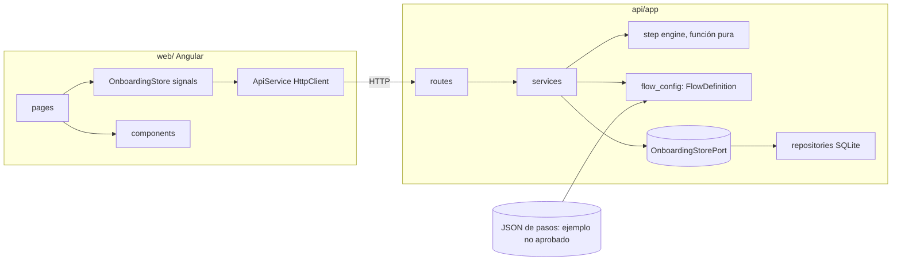

# Impacto de arquitectura: `user-onboarding-mvp-completion` (HU-ONB, issue #28)

Fecha: 2026-11-06. Rol: Wallet Architect. Estado: **propuesta pendiente de aprobación humana** (alcance, contratos, riesgos y estrategia de pruebas). No se implementa código funcional hasta esa aprobación.

Fuentes: [proposal](../../openspec/changes/user-onboarding-mvp-completion/proposal.md), [design](../../openspec/changes/user-onboarding-mvp-completion/design.md), [spec](../../openspec/changes/user-onboarding-mvp-completion/specs/user-onboarding-mvp-completion/spec.md), [tasks](../../openspec/changes/user-onboarding-mvp-completion/tasks.md), [historia](../stories/user-onboarding-mvp-completion.sp.md), [constitución](../WALLET-CONSTITUTION.md), [OQ](../OPEN-QUESTIONS.md), [glosario](../GLOSSARY.md), [trazabilidad](../TRACEABILITY.md), [AGENTS.md](../../AGENTS.md). Convenciones heredadas de [payment-idempotency-protection-impact.md](payment-idempotency-protection-impact.md). Evidencias: [docs/evidence/user-onboarding-mvp-completion/](../evidence/user-onboarding-mvp-completion/README.md).

## 1. Hallazgos previos

- `design.md` no elige tecnología. Se reutiliza el stack ya aprobado en HU-IDEM (Python 3.12, FastAPI, SQLite, `X-Payer-Id` provisional, P-1 y P-3) y se añade `web/` (Angular), supuesto de esta propuesta sujeto a aprobación (ver Q-8).
- Estado real de `api/` (52 pruebas pasan): `create_app(provider, settings, store, clock)` con servicios en `app.state.services`; `Settings` es un `dataclass` congelado con valores provisionales por entorno; `RequestContext.payer_id` sale de `X-Payer-Id`; errores como `HTTPException(detail=...)`. Rutas existentes: `/payments`, `/payments/{id}`, `/payments/{id}/retries`, `/idempotency/requests`. Ninguna colisiona con las rutas nuevas.
- **Trampa de integración detectada:** `Settings.db_path` por defecto es `idempotency.sqlite3` (ruta relativa) y los fixtures existentes llaman a `create_app(settings=make_settings(), store=...)`. Si `create_app` creara siempre un almacén de onboarding, las 52 pruebas existentes crearían ese archivo en el directorio de trabajo. Por eso el onboarding se activa **solo si hay flujo configurado** (sección 3.3).
- No existen `web/` ni `auth/` en esta rama. El `.gitignore` raíz ya ignora `node_modules`, `.angular` y `dist`, pero **no** `*.sqlite3` (riesgo RS-06 de HU-IDEM; ver R-9).
- Mock `wallet-mocks` (solo lectura, 2026-11-06): `wallet_health` = `ok` (SQLite). Escenarios KYC: `APPROVED` (wallet activa), `REJECTED` (rechaza), `MANUAL_REVIEW` (deja `PENDING`), `UNAVAILABLE` (503 sin crear wallet). Su wallet y su estado son del **proveedor**; el estado `activo`/`pendiente` de ONB es **local** de esta app (decisión D-3).
- Glosario: «activación» tiene dos significados. Los nombres de eventos y atributos de este cambio son `onboarding_*`, `user_id` y `wallet_status`; ninguno reutiliza «activación del pagador».

## 2. Decisión: el KYC mock queda fuera de esta fase (sin puerto)

| Criterio | Evaluación |
|---|---|
| Spec | No define ningún comportamiento de rechazo, revisión manual ni indisponibilidad de KYC; solo «finalizar correctamente → `activo`». Un puerto de KYC obligaría a inventar esos comportamientos (principios 1 y 4). |
| OQ-19 | Decidida: solo motor configurable; los pasos reales de KYC los define Cumplimiento. Elegir ahora cómo se verifica sería anticiparse a su definición. |
| Valor | El motor se prueba por completo con validación local de reglas; el mock KYC no aporta pruebas de ningún requisito de la spec. |
| Costo | Tres estados nuevos (`PENDING`, rechazo, 503) que tocan UX, máquina de estados de la wallet y eventos. |

**Decisión D-1:** no hay `KycProviderPort`. Punto de extensión documentado, sin código: cuando Cumplimiento defina verificación contra proveedor, un cambio nuevo (vía `opsx update`) añadirá un puerto opcional por paso referenciado desde la configuración (p. ej., campo `verifier`), mapeando `APPROVED`→paso completo, `REJECTED`→error accionable, `MANUAL_REVIEW`→estado pendiente y `UNAVAILABLE`→reintento. El contrato de configuración (sección 6) reserva `schema_version` para ello.

## 3. Componentes y capas



### 3.1 API

| Capa | Responsabilidad | No hace |
|---|---|---|
| `routes` | HTTP, esquemas Pydantic, identidad (`request_context`), mapeo de excepciones a HTTP | Reglas de pasos, SQL |
| `services` | Motor de pasos (estado, validación, avance, cierre), eventos, acceso por wallet, salida analítica | HTTP, SQL |
| `services/step_engine` | Función pura `validate_step_values` | I/O |
| `services/flow_config` | Cargar y validar el contrato de configuración; produce `FlowDefinition` inmutable | Conocer pasos concretos |
| `ports` | `OnboardingStorePort` (un solo puerto, ver D-2) | Implementación |
| `repositories` | SQLite parametrizado y transacciones atómicas | Reglas de negocio |

### 3.2 Puertos: uno solo, con motivo real

`OnboardingStorePort` es el único puerto nuevo (D-2). Motivo: el cierre exitoso debe ser **atómico** (sesión `COMPLETED` + wallet `activo` + evento de cierre, diseño decisión 4) y los eventos deben deduplicarse en la misma transacción que la transición que los origina (tarea 5.2). Eso exige un único almacén transaccional; separar sesión, wallet y eventos en puertos distintos rompería la atomicidad.

No se crean puertos para: KYC (D-1), gasto de adquisición (bloqueado por OQ-22; ver sección 9), reloj (se inyecta `Callable[[], datetime]` como en HU-IDEM), generador de ids (función `new_onboarding_id()` como `new_payment_id()`), ni publicación de eventos (los eventos se persisten; no hay bus).

### 3.3 Cableado en `create_app` (compatible hacia atrás)

```python
def create_app(provider, settings=None, store=None, clock=_utc_now, *,
               onboarding_flow: FlowDefinition | None = None,
               onboarding_store: OnboardingStorePort | None = None) -> FastAPI: ...
```

- Los parámetros nuevos son **solo por palabra clave** y opcionales: las llamadas actuales no cambian.
- El onboarding se habilita si `onboarding_flow` se pasa o `settings.onboarding.steps_config_path` no está vacío (se carga al iniciar; configuración inválida detiene el arranque con `FlowConfigError`). Entonces `onboarding_store` por defecto es `SqliteOnboardingStore(settings.db_path, clock)` (mismo archivo SQLite, tablas propias).
- Sin flujo configurado: `app.state.services.onboarding`, `.wallet_access` y `.onboarding_analytics` son `None`; las rutas nuevas responden `503 ONBOARDING_NOT_CONFIGURED`, no se crea ningún archivo y las rutas de pagos siguen igual.
- Sin recarga en caliente: los pasos se leen al arrancar (cambiar pasos = redeploy). No hay paso de ejemplo cargado por defecto en producción: se activa solo por `ONB_STEPS_CONFIG_PATH`.

## 4. Árbol de carpetas exacto a crear o modificar

`(M)` = modificar archivo existente (cambio aditivo, sin alterar firmas actuales); `(N)` = nuevo.

```
api/
  config/
    onboarding-steps.example.json            (N) configuración «ejemplo no aprobado» (sección 6.3)
  app/
    config.py                                (M) añade OnboardingSettings dentro de Settings y su carga por entorno
    errors.py                                (M) añade excepciones de onboarding
    main.py                                  (M) cableado condicional del onboarding (3.3)
    schemas_onboarding.py                    (N) modelos Pydantic de entrada y salida
    ports/
      onboarding_store.py                    (N) Protocol OnboardingStorePort + dataclasses y constantes
    repositories/
      sqlite_support.py                      (N) TIMESTAMP_FORMAT, to_text, to_datetime y connection(db_path)
      sqlite_store.py                        (M) usa sqlite_support (refactor sin cambio de comportamiento; Q-9)
      sqlite_onboarding_store.py             (N) implementa OnboardingStorePort
    routes/
      onboarding.py                          (N) /onboarding/*
      wallet.py                              (N) /wallet, /wallet/payments-entry y dependencia require_active_wallet
      onboarding_analytics.py                (N) /analytics/onboarding/*
    services/
      flow_config.py                         (N) FlowDefinition, StepDefinition, FieldDefinition, RuleDefinition, loader
      step_engine.py                         (N) validate_step_values (pura)
      onboarding_service.py                  (N) start_or_resume, get_current, submit_step, close
      wallet_access_service.py               (N) is_active, require_active
      onboarding_analytics_service.py        (N) monthly_output, duration_report
  tests/
    conftest.py                              (M) solo se añaden fixtures; ninguno existente cambia
    data/
      onboarding-flow-alternate.json         (N) otra configuración «ejemplo no aprobado» (prueba 2.1)
    unit/
      test_onboarding_settings.py            (N)
      test_flow_config.py                    (N)
      test_step_engine.py                    (N)
      test_sqlite_onboarding_store.py        (N)
      test_onboarding_service.py             (N)
      test_wallet_access_service.py          (N)
      test_onboarding_analytics_service.py   (N)
      test_app_wiring_onboarding.py          (N) sin flujo: sin archivo y rutas de pagos intactas
    acceptance/
      test_onboarding_flow_acceptance.py     (N) recorrido completo (7.1)

web/                                         (N) toda la carpeta
  package.json                               dependencias: solo las de Angular + angular-eslint (dev)
  package-lock.json
  angular.json
  tsconfig.json
  tsconfig.app.json
  tsconfig.spec.json
  eslint.config.js                           reglas de accesibilidad de plantillas (angular-eslint)
  proxy.conf.json                            /wallet-api -> http://localhost:8000 (sin CORS en la API)
  README.md                                  ejecución, proxy, identidad de prueba, comandos de prueba
  public/
    favicon.ico
  src/
    index.html                               lang="es-PE", meta viewport, título
    main.ts
    styles.css                               tokens, foco visible, .visually-hidden, prefers-reduced-motion
    app/
      app.ts  app.html  app.css  app.spec.ts           raíz: <main>, router-outlet, región aria-live global
      app.config.ts                          provideRouter, provideHttpClient(withInterceptors), APP_CONFIG
      app.routes.ts                          /onboarding, /payments (guard), '' -> /onboarding
      core/
        config/
          app-config.ts                      InjectionToken APP_CONFIG {apiBaseUrl, testUserId}
        http/
          user-identity.interceptor.ts       añade X-Payer-Id (identidad de prueba)
          user-identity.interceptor.spec.ts
          api-error.ts                       HttpErrorResponse -> ApiError tipado
          api-error.spec.ts
      features/
        onboarding/
          onboarding.routes.ts
          onboarding.copy.ts                 textos de interfaz y claves centralizadas (sin valores mágicos)
          data/
            onboarding.models.ts             interfaces: FlowView, StepView, FieldView, OnboardingView, FieldError, ...
            onboarding-api.service.ts        getFlow, startOrResume, getCurrent, submitStep, close
            onboarding-api.service.spec.ts
          state/
            onboarding.store.ts              signals: flow, onboarding, status, fieldErrors; computed: currentStep, progress
            onboarding.store.spec.ts
          components/
            step-indicator/                  step-indicator.ts .html .css .spec.ts
            step-form/                       step-form.ts .html .css .spec.ts   (FormRecord tipado)
            form-field/                      form-field.ts .html .css .spec.ts
            error-summary/                   error-summary.ts .html .css .spec.ts
            flow-approval-notice/            flow-approval-notice.ts .html .css .spec.ts
          pages/
            onboarding-page/                 onboarding-page.ts .html .css .spec.ts   (contenedor)
            onboarding-done/                 onboarding-done.ts .html .css .spec.ts   (wallet activa)
        wallet/
          wallet.routes.ts
          data/
            wallet-api.service.ts            getWallet, checkPaymentsEntry
            wallet-api.service.spec.ts
          guards/
            active-wallet.guard.ts           CanActivateFn
            active-wallet.guard.spec.ts
          pages/
            payments-entry-page/             payments-entry-page.ts .html .css .spec.ts   (marcador; lo reemplaza PAYER)

docs/architecture/user-onboarding-mvp-completion-impact.md     este documento
docs/evidence/user-onboarding-mvp-completion/README.md         índice de evidencias
```

No se tocan `payment_service`, `retry_service`, `request_audit_service`, `routes/payments.py`, `routes/idempotency_audit.py`, `schemas.py` ni ninguna prueba existente.

## 5. Endpoints propuestos

Rutas nuevas; no tocan los contratos protegidos (principio 18) ni las rutas de HU-IDEM. Identidad: `request_context` (`X-Payer-Id`, P-3), sin tomar identidad del cuerpo. En onboarding el valor se persiste como `user_id`.

Errores de onboarding: `{"detail": {"code": "<CODIGO>", "message": "<texto accionable>"}}`; el 422 de pasos añade `errors`. Los mensajes son estáticos y **nunca reflejan valores enviados**.

| Método y ruta | Entrada | Salida |
|---|---|---|
| `GET /onboarding/flow` | — | 200 `FlowView`: `flow_id`, `approval_status`, `label`, pasos con `id`, `order`, `title`, `description`, campos (`name`, `type`, `label`, `hint`, `required`, `max_length`, `autocomplete`, `input_mode`). **No** expone patrones ni mensajes de reglas. 503 si no hay flujo |
| `POST /onboarding` | sin cuerpo | 201 sesión creada (cohorte asignada, wallet `pendiente`, evento de inicio); 200 sesión existente del usuario (reanudar; también si ya está `COMPLETED`). `OnboardingView` |
| `GET /onboarding/current` | — | 200 `OnboardingView`; 404 `ONBOARDING_NOT_FOUND` |
| `PUT /onboarding/{onboarding_id}/steps/{step_id}` | `{"values": {campo: str \| bool}}` | 200 `OnboardingView` con el paso completado y el siguiente como actual; 200 idempotente si el paso ya estaba completado (sin evento nuevo ni cambio); 422 `STEP_VALIDATION_FAILED` con `errors[{field, rule, message}]`; 409 `STEP_NOT_CURRENT`; 404 `STEP_NOT_FOUND` / `ONBOARDING_NOT_FOUND` |
| `POST /onboarding/{onboarding_id}/close` | sin cuerpo | 200 `OnboardingView` con `status=COMPLETED` y `wallet_status=activo` (también al repetir: idempotente); 409 `ONBOARDING_INCOMPLETE` con `pending_step_ids` |
| `GET /wallet` | — | 200 `{status, activated_at}`; 404 si el usuario no tiene wallet |
| `GET /wallet/payments-entry` | — | 200 `{allowed: true}` con wallet `activo`; 403 `WALLET_NOT_ACTIVE` con `next_action: "complete_onboarding"` |
| `GET /analytics/onboarding/monthly?month=YYYY-MM` | encabezado `X-Analytics-Token` | 200 `MonthlyOutputView` (sección 9.1); 404 si el token no está configurado (cerrado por defecto); 401 token incorrecto |
| `GET /analytics/onboarding/duration?month=YYYY-MM` | encabezado `X-Analytics-Token` | 200 `DurationReportView` (sección 9.2); mismos 404 y 401 |

- Propiedad: `onboarding_id` ajeno responde 404 igual que inexistente (sin enumeración).
- Los eventos **no se reciben del cliente**: los emite el servidor al ocurrir cada transición. Así los reintentos del cliente no pueden crear eventos (tarea 5.2) y no hay endpoint de ingestión que proteger.
- `PUT` por paso (no `POST`): reenviar el mismo paso es seguro por diseño.
- El acceso a pagos (`/payments`) **no** se condiciona a `activo` en este cambio (Q-1); se entrega la dependencia `require_active_wallet` para que PAYER la aplique.

## 6. Contrato de configuración de pasos (tarea 1.7)

Archivo JSON (solo biblioteca estándar; sin dependencias nuevas), cargado una vez al arrancar y validado con error explícito si no cumple. El motor solo interpreta esta estructura y no conoce pasos concretos.

### 6.1 Estructura

| Nivel | Campo | Tipo | Obligatorio | Regla de validación al cargar |
|---|---|---|---|---|
| Flujo | `schema_version` | entero | sí | debe ser `1` |
| Flujo | `flow_id` | texto | sí | patrón `^[a-z0-9-]{1,40}$` |
| Flujo | `approval_status` | `"approved"` \| `"example_not_approved"` | sí | cualquier otro valor se rechaza |
| Flujo | `label` | texto | sí si `approval_status != approved` | texto visible; para el ejemplo es la etiqueta «ejemplo no aprobado» |
| Flujo | `steps` | lista | sí | al menos 1 paso |
| Paso | `id` | texto | sí | patrón `^[a-z0-9-]{1,40}$`, único en el flujo |
| Paso | `order` | entero ≥ 1 | sí | único; el motor ordena por `order` |
| Paso | `title` | texto | sí | 1 a 80 caracteres |
| Paso | `description` | texto | no | hasta 300 caracteres |
| Paso | `fields` | lista | sí | al menos 1 campo |
| Campo | `name` | texto | sí | patrón `^[a-z][a-z0-9_]{0,39}$`, único dentro del paso |
| Campo | `type` | `"text"` \| `"checkbox"` | sí | vocabulario cerrado |
| Campo | `label` | texto | sí | 1 a 80 caracteres |
| Campo | `hint` | texto | no | hasta 200 caracteres |
| Campo | `required` | booleano | sí | en `checkbox`, `true` exige que esté marcado |
| Campo | `required_message` | texto | sí si `required` | mensaje accionable, 1 a 200 caracteres |
| Campo | `autocomplete`, `input_mode` | texto | no | tokens HTML estándar (WCAG 1.3.5); solo se publican, el motor no los interpreta |
| Campo | `rules` | lista | no | solo en `text`; ver 6.2 |
| Regla | `kind` | `"min_length"` \| `"max_length"` \| `"pattern"` | sí | vocabulario cerrado |
| Regla | `value` | entero (longitudes) o texto (patrón) | sí | patrón: compila con `re`, máximo 200 caracteres |
| Regla | `message` | texto | sí | mensaje accionable, 1 a 200 caracteres; **una regla sin mensaje se rechaza al cargar** (tarea 3.2) |

Restricciones adicionales al cargar: todo campo `text` declara una regla `max_length` ≤ 500 (acota la entrada y mitiga ReDoS, R-4); mensajes sin HTML.

### 6.2 Semántica del motor (idéntica para cualquier configuración)

1. Paso actual = primer paso por `order` sin completar. Solo el paso actual acepta datos; uno posterior responde `STEP_NOT_CURRENT`; uno ya completado responde 200 idempotente sin tocar nada.
2. Validación de un paso, por campo y en el orden de `fields`: valores desconocidos → error `unknown_field`; texto: `strip()`, vacío y `required` → error `required` con `required_message`; vacío y no requerido → sin más reglas; si no, se evalúan las `rules` en orden y **la primera que falla** produce un único error por campo con su `message` (`pattern` con `re.fullmatch`). Checkbox requerido y no marcado → `required`.
3. Si hay algún error: el paso no avanza, no se registra evento y se responde 422 con todos los errores del paso.
4. Sin errores: se registran el paso completado y su evento en una sola transacción; el siguiente paso pasa a ser actual.
5. Cierre: solo con todos los pasos completados; si no, `ONBOARDING_INCOMPLETE`.
6. Los valores enviados **no se persisten ni se registran** (D-5); solo se guarda que el paso se completó y cuándo.

### 6.3 Configuración de ejemplo (`api/config/onboarding-steps.example.json`)

Etiquetada **«ejemplo no aprobado»**: no representa requisitos de KYC ni regulatorios. Documentos ficticios con prefijo `TEST-` (principio 16).

```json
{
  "schema_version": 1,
  "flow_id": "onboarding-ejemplo",
  "approval_status": "example_not_approved",
  "label": "Ejemplo no aprobado: estos pasos son solo para demostración y pruebas; no son requisitos de KYC ni regulatorios.",
  "steps": [
    {
      "id": "datos-personales", "order": 1,
      "title": "Tus datos (ejemplo no aprobado)",
      "description": "Completa tus datos para continuar.",
      "fields": [
        { "name": "full_name", "type": "text", "label": "Nombre completo", "required": true,
          "required_message": "Escribe tu nombre completo.",
          "autocomplete": "name", "input_mode": "text",
          "rules": [
            { "kind": "max_length", "value": 100, "message": "Acorta tu nombre a 100 caracteres como máximo." },
            { "kind": "pattern", "value": "[A-Za-zÁÉÍÓÚÜÑáéíóúüñ' .-]{2,100}",
              "message": "Usa solo letras y espacios; por ejemplo: Ana Torres." }
          ] },
        { "name": "document_number", "type": "text", "label": "Número de documento de prueba",
          "hint": "Formato de prueba: TEST- seguido de letras o números, por ejemplo TEST-12345.",
          "required": true, "required_message": "Escribe el número de documento de prueba.",
          "input_mode": "text",
          "rules": [
            { "kind": "max_length", "value": 25, "message": "Acorta el documento a 25 caracteres como máximo." },
            { "kind": "pattern", "value": "TEST-[A-Za-z0-9]{1,20}",
              "message": "Escribe el documento de prueba con el formato TEST-12345." }
          ] }
      ]
    },
    {
      "id": "contacto", "order": 2,
      "title": "Contacto (ejemplo no aprobado)",
      "fields": [
        { "name": "phone", "type": "text", "label": "Celular", "hint": "9 dígitos, sin espacios.",
          "required": true, "required_message": "Escribe tu número de celular.",
          "autocomplete": "tel-national", "input_mode": "tel",
          "rules": [
            { "kind": "max_length", "value": 9, "message": "El celular tiene 9 dígitos; elimina los sobrantes." },
            { "kind": "pattern", "value": "9[0-9]{8}", "message": "Escribe 9 dígitos que empiecen con 9; por ejemplo: 912345678." }
          ] }
      ]
    },
    {
      "id": "aceptacion", "order": 3,
      "title": "Confirmación (ejemplo no aprobado)",
      "fields": [
        { "name": "accept_terms", "type": "checkbox", "label": "Acepto los términos de ejemplo",
          "required": true, "required_message": "Marca la casilla para aceptar los términos y continuar." }
      ]
    }
  ]
}
```

`api/tests/data/onboarding-flow-alternate.json` define otros pasos y orden (también «ejemplo no aprobado») para demostrar que cambiar la configuración cambia los pasos sin cambiar el comportamiento. Cargar los pasos reales de Cumplimiento = nuevo JSON con `approval_status: "approved"`, sin cambio de código.

## 7. Modelo de datos (SQLite, mismo archivo que HU-IDEM, tablas propias)

Marcas de tiempo UTC con el formato de ancho fijo de `sqlite_store` (el orden de texto es el orden temporal). Consultas parametrizadas. Una conexión por operación, WAL y `busy_timeout` como en HU-IDEM.

**`onboarding_sessions`** (una por usuario: `UNIQUE(user_id)`; reanudar en vez de reiniciar)

| Columna | Nota |
|---|---|
| `onboarding_id` PK | `ob_` + uuid4 hex |
| `user_id` UNIQUE NOT NULL | valor de `X-Payer-Id` (identidad provisional) |
| `cohort` NOT NULL | asignada al iniciar desde configuración (OQ-06 provisional) |
| `status` | `IN_PROGRESS` \| `COMPLETED` |
| `started_at`, `updated_at` NOT NULL | `updated_at` permite medir inactividad más adelante sin cambio de esquema (OQ-21) |
| `closed_at` NULL | se fija solo en el cierre exitoso |

**`onboarding_step_progress`** — `PRIMARY KEY (onboarding_id, step_id)`, `completed_at`. Sin valores de campos (D-5). La PK hace imposible duplicar un paso.

**`onboarding_events`** (append-only con triggers `RAISE(ABORT)` como `payment_requests`)

| Columna | Nota |
|---|---|
| `seq` PK AUTOINCREMENT | |
| `onboarding_id`, `user_id`, `cohort` | cohorte copiada al evento (criterio 4) |
| `event_type` | `CHECK IN ('onboarding_started','onboarding_step_completed','onboarding_closed')` |
| `step_id` NOT NULL DEFAULT `''` | vacío salvo en `onboarding_step_completed` |
| `occurred_at` | reloj del servidor |
| `UNIQUE (onboarding_id, event_type, step_id)` | deduplicación (5.2) con `INSERT OR IGNORE` |

**`wallets`** — `user_id` PK, `status` (texto libre: `activo` fijo por la spec; el previo viene de configuración, OQ-23), `created_at`, `activated_at` NULL.

Transacciones atómicas (todas en una sola transacción SQLite):

| Operación del puerto | Escribe |
|---|---|
| `start_onboarding` | sesión + wallet con estado previo + evento `onboarding_started`. Si `UNIQUE(user_id)` falla devuelve la existente (`created=False`) |
| `record_step_completed` | fila de progreso + evento de paso; devuelve `False` si ya existía |
| `close_onboarding` | `UPDATE sesión ... WHERE status='IN_PROGRESS'` (filas afectadas = 1 gana la carrera) + wallet a `activo` + evento `onboarding_closed`; si filas = 0 devuelve la sesión ya cerrada (`closed_now=False`) |

La verificación «todos los pasos completados» la hace el servicio antes del cierre. Es seguro porque el progreso es solo de inserción y la configuración no cambia en caliente.

### 7.1 Estados de la wallet

`pendiente` (provisional, OQ-23, propuesta no aprobada, desde configuración) → `activo` (fijo por la spec), solo por `close_onboarding`. Un usuario sin fila en `wallets` se trata como no activo. No hay transición de vuelta en este cambio.

## 8. Eventos de analítica

| Evento (`event_type`) | Cuándo | `step_id` | Dedup |
|---|---|---|---|
| `onboarding_started` | al crear la sesión | vacío | una vez por sesión |
| `onboarding_step_completed` | al completar con éxito un paso | id del paso | una vez por paso |
| `onboarding_closed` | al cierre **exitoso** (`COMPLETED`) | vacío | una vez por sesión |

Todos con `occurred_at`, `onboarding_id`, `user_id` y `cohort`. No hay evento de abandono (OQ-21 provisional: cierre solo por finalización exitosa; el abandono por inactividad se podrá derivar de `updated_at`). No hay evento de validación fallida (supuesto S-5). Nombres distintos del «evento de activación del pagador» de PAYER.

## 9. Salida analítica

### 9.1 Mensual (tarea 6.1 y contrato de 6.2)

`GET /analytics/onboarding/monthly?month=2026-11`:

```json
{
  "month": "2026-11",
  "cohort": "MVP-PE",
  "new_active_users": 0,
  "acquisition_spend": { "status": "unavailable", "amount_pen_cents": null },
  "reference": { "mau_min": 1000, "mau_max": 2000, "cac_target_pen_cents": 1000 },
  "pending_definitions": ["OQ-05", "OQ-22"]
}
```

- `new_active_users`: sesiones `COMPLETED` de la cohorte con `closed_at` dentro del mes (en el desfase horario configurado). No cuenta onboardings no finalizados.
- `acquisition_spend`: contrato `{status: "available" | "unavailable", amount_pen_cents: int | null}`. **Mientras OQ-22 siga abierta se informa siempre `unavailable` con `null`, nunca `0`** (escenario «Mes sin gasto disponible»).
- El CAC no se calcula en esta salida; `reference` aporta los parámetros configurables (rango de MAU y PEN 10 en céntimos, coherente con `amount_cents` de la API).

**Qué queda bloqueado por OQ-22 (tarea 6.2):** la fuente y el momento de captura del gasto, la definición de «usuario nuevo» para CAC y, por tanto, cualquier valor `available`, el escenario «Atribución de gasto de adquisición» y su prueba, y la verificación del CAC. **No se diseña puerto ni tabla de gasto** hasta que OQ-22 se responda. Lo que sí se entrega: el campo con estado `unavailable`, los parámetros de referencia y la prueba del escenario «Mes sin gasto disponible». La tarea 6.2 permanece abierta.

### 9.2 Duración (tarea 5.3)

`GET /analytics/onboarding/duration?month=2026-11`:

```json
{
  "month": "2026-11",
  "cohort": "MVP-PE",
  "finished_onboardings": 0,
  "median_minutes": null,
  "reference": { "baseline_minutes": 8, "target_minutes": 3 },
  "boundary": { "start": "onboarding_started", "end": "onboarding_closed", "status": "provisional_oq20" }
}
```

- Duración por onboarding = `occurred_at` del evento de fin menos el del evento de inicio; el onboarding pertenece al mes del evento de fin. `median_minutes` es la mediana en minutos (`null` sin datos, no `0`). Se calcula en el servicio con la biblioteca estándar.
- La frontera es configurable (`ONB_DURATION_START_EVENT` / `ONB_DURATION_END_EVENT`, formato `event_type[:step_id]`); el valor por defecto es la propuesta no aprobada de OQ-20 y se publica con `status: provisional_oq20`. La tarea 5.3 no se cierra hasta que 1.2 fije la frontera; se prueba con una frontera de prueba (por ejemplo, fin = paso `contacto`).
- Los valores 8 y 3 son parámetros, no resultados garantizados. El reporte periódico lo obtiene Analítica llamando al endpoint; la programación del reporte consolidado (OQ-07) queda fuera.

### 9.3 Acceso a la salida

Los agregados no contienen datos personales, pero no hay roles definidos. Se exige `X-Analytics-Token` comparado en tiempo constante con `ONB_ANALYTICS_TOKEN`; sin variable configurada los endpoints responden 404 (Q-4). Es un valor de entorno, nunca real en el repositorio (valor de prueba aislado en las pruebas).

## 10. Configuración (provisional, no codificada)

`Settings` gana `onboarding: OnboardingSettings` (dataclass congelado con valores por defecto, para no alterar `Settings(**overrides)` de los fixtures). Variables de entorno:

| Variable | Valor por defecto | Origen |
|---|---|---|
| `ONB_STEPS_CONFIG_PATH` | vacío = onboarding deshabilitado (503) | OQ-19 |
| `ONB_COHORT` | `MVP-PE` (propuesta no aprobada) | OQ-06 |
| `ONB_WALLET_PENDING_STATUS` | `pendiente` (propuesta no aprobada) | OQ-23 |
| `ONB_DURATION_START_EVENT` | `onboarding_started` (propuesta no aprobada) | OQ-20 |
| `ONB_DURATION_END_EVENT` | `onboarding_closed` (propuesta no aprobada) | OQ-20 |
| `ONB_REPORT_UTC_OFFSET_MINUTES` | `-300` (supuesto S-2, alineado con la propuesta no aprobada de OQ-35) | supuesto |
| `ONB_REF_DURATION_BASELINE_MINUTES` / `ONB_REF_DURATION_TARGET_MINUTES` | `8` / `3` | épica |
| `ONB_REF_MAU_MIN` / `ONB_REF_MAU_MAX` | `1000` / `2000` | épica |
| `ONB_REF_CAC_TARGET_CENTS` | `1000` (PEN 10) | épica |
| `ONB_ANALYTICS_TOKEN` | vacío = salida analítica deshabilitada | seguridad |
| `IDEM_DB_PATH` (existente) | se reutiliza | HU-IDEM |

Ningún valor se fija en servicios ni specs; `config.py` los lee y los inyecta.

## 11. Reglas de validación bloqueante y mensajes accionables

Toda regla y mensaje sale de configuración. Las del ejemplo (sección 6.3) cubren los tres tipos de la spec y cada una lleva su mensaje:

| Caso | Regla | Mensaje (ejemplo no aprobado) |
|---|---|---|
| Dato faltante | `required` | «Escribe tu nombre completo.» / «Marca la casilla para aceptar los términos y continuar.» |
| Dato inválido por formato | `pattern` | «Escribe el documento de prueba con el formato TEST-12345.» |
| Dato inválido por longitud | `max_length` | «Acorta tu nombre a 100 caracteres como máximo.» |
| Cambio de regla | edición del JSON | nueva regla y nuevo mensaje, mismo comportamiento de bloqueo |

Criterios de calidad del mensaje (verificados por revisión, no por código): dice **qué dato** y **cómo corregirlo**, está en español, no refleja el valor enviado y no tiene HTML. Los textos reales los define Producto/Cumplimiento.

## 12. Mapeo de tareas a módulos y pruebas

Las pruebas se escriben **antes** (rojo) y la implementación después. Pruebas API con SQLite real en archivo temporal (sin doble del almacén); cobertura del código nuevo ≥ 85 %.

| Tarea | Módulo(s) | Pruebas que la protegen |
|---|---|---|
| 1.1 a 1.6 | documentos (Cumplimiento, Producto, Analítica) | Sin código; acuerdos y verificación de OQ en `implementation-log.md` |
| 1.7 | sección 6, `services/flow_config.py`, `api/config/onboarding-steps.example.json` | `test_flow_config`: ejemplo válido; rechazo de `schema_version` desconocido, ids u órdenes repetidos, tipo o regla fuera del vocabulario, patrón que no compila, regla o `required` sin mensaje, `text` sin `max_length`, `approval_status` inválido; el ejemplo declara `example_not_approved` y su etiqueta |
| 2.1 | `flow_config`, `onboarding_service`, `routes/onboarding.py` (`GET /onboarding/flow`) | `test_onboarding_service`: con el ejemplo y con `onboarding-flow-alternate.json` la secuencia, el orden y el paso actual coinciden con la configuración; mismo motor y mismo comportamiento (bloqueo, progreso, eventos, activación) con ambas |
| 2.2 | API: `OnboardingView` con estados `completed/current/pending`; web: `step-indicator`, `onboarding-page`, `onboarding.store` | API: inicio muestra todos los pasos y el primero actual; avanzar actualiza el actual; tras un 422 el actual no cambia. Web: `step-indicator.spec` (lista ordenada, `aria-current="step"` solo en el actual, texto «Paso n de m», estado no solo por color), `onboarding.store.spec` |
| 3.1 | `services/step_engine.py`, `onboarding_service.submit_step`, `PUT .../steps/...`; web: `step-form`, `error-summary`, `form-field` | `test_step_engine`: dato faltante, inválido, corrección, cambio de regla configurada, un error por campo, campo desconocido, checkbox. API: 422 y sin evento; 409 fuera de orden; 200 idempotente. Web: errores del servidor mapeados a controles, foco en el resumen, valores conservados |
| 3.2 | `flow_config` (mensaje obligatorio), `step_engine` | Todas las reglas y `required` del ejemplo tienen mensaje no vacío; los errores devuelven el mensaje configurado; un valor enviado no aparece en la respuesta |
| 4.1 | `sqlite_onboarding_store.close_onboarding`, `onboarding_service.close`, `POST .../close` | Cierre correcto → `COMPLETED` y wallet `activo` con `activated_at`; incompleto → 409 y wallet sigue `pendiente`; cierre repetido → 200 sin efectos nuevos (un solo evento de cierre); 20 hilos cerrando → un solo `closed_now=True` |
| 4.2 | `wallet_access_service`, `routes/wallet.py`, dependencia `require_active_wallet`; web: `active-wallet.guard`, `payments-entry-page` | `test_wallet_access_service` y API: `activo` → 200; `pendiente`, sin wallet o sin onboarding → 403 `WALLET_NOT_ACTIVE`. Web: el guard permite o redirige a `/onboarding` |
| 5.1 | `sqlite_onboarding_store` (eventos en la misma transacción), `onboarding_service` | Inicio, cada paso y cierre generan su evento con `occurred_at`, `onboarding_id`, `cohort`; un paso rechazado no genera evento; el abandono no genera evento de cierre |
| 5.2 | `UNIQUE` + `INSERT OR IGNORE` | Reenviar el mismo paso, el cierre y el inicio varias veces (y en hilos) deja un único evento por (onboarding, tipo, paso); los triggers impiden `UPDATE` y `DELETE` |
| 5.3 | `onboarding_analytics_service.duration_report`, `routes/onboarding_analytics.py` | Mediana con datos de ejemplo y reloj controlado; excluye onboardings sin evento de fin; `null` sin datos; frontera de prueba distinta de la provisional; cierra solo tras 1.2 |
| 6.1 | `onboarding_analytics_service.monthly_output` | Conteo del mes por cohorte, excluyendo no finalizados, otro mes y otra cohorte; desfase horario; 404 sin token configurado y 401 con token incorrecto |
| 6.2 | contrato en `MonthlyOutputView` | **Bloqueada por OQ-22.** Solo prueba que `acquisition_spend` es `unavailable`/`null` y nunca `0` y que `reference` lleva los parámetros; la tarea sigue abierta |
| 6.3 | sección 9 de este documento | `test_monthly_output_fields_match_documented`: las claves devueltas coinciden con las documentadas; glosario aprobado (1.3) |
| 7.1 | todo | `acceptance/test_onboarding_flow_acceptance.py`: inicio → error → corrección → pasos → cierre → `activo` → acceso a `/wallet/payments-entry` y coherencia de eventos. Web: recorrido manual contra la API real registrado en `qe-test-evidence.md` (Q-12) |

Regresión: antes y después de cada fase, `pytest` completo debe mostrar las 52 pruebas existentes en verde y la cobertura mínima de `pyproject.toml` intacta.

## 13. Estrategia de pruebas

### 13.1 API (pytest, SQLite real)

- Servicios reales sobre `SqliteOnboardingStore` en archivo temporal; reloj `MutableClock` existente. Sin doble del almacén para validar `UNIQUE`, triggers y atomicidad reales.
- Concurrencia con hilos (como `test_sqlite_store_concurrency`) para inicio, paso y cierre.
- `test_app_wiring_onboarding`: sin flujo, `create_app` sigue funcionando, no se crea ningún archivo SQLite y las rutas nuevas devuelven 503; con flujo se montan.
- Seguridad: consultas parametrizadas; propiedad por `user_id`; mensajes sin eco de valores; token de analítica en tiempo constante; sin valores en logs.

### 13.2 Web (herramienta estándar de Angular: `ng test`)

- Se usa el ejecutor de pruebas que trae el CLI de la versión elegida (Vitest en las versiones recientes; Karma y Jasmine en las anteriores). No se añaden Jest, Cypress ni Playwright.
- Servicios: `provideHttpClient()` + `provideHttpClientTesting()` + `HttpTestingController` (URL, método, cuerpo y encabezado `X-Payer-Id`).
- Store: API simulada; transiciones de `status`, `fieldErrors`, `currentStep` y `progress` como signals.
- Componentes (`TestBed`, `ChangeDetectionStrategy.OnPush`): formulario construido **dinámicamente** desde `FlowView` (con dos definiciones distintas se obtienen otros campos con el mismo componente); errores asociados al control; foco; región `aria-live`.
- Sin `any`; tipos de DTO explícitos.

### 13.3 Accesibilidad y UX: qué se verifica y cómo

| Verificación | Cómo | Criterio WCAG 2.2 AA |
|---|---|---|
| Plantillas sin faltas básicas (etiquetas, roles, `alt`, orden de foco) | `ng lint` con reglas de accesibilidad de `angular-eslint` | 1.1.1, 1.3.1, 4.1.2 |
| Indicador de pasos con `aria-current="step"`, texto «Paso n de m» y estado en texto | prueba de componente | 1.3.1, 1.4.1 |
| Foco al cambiar de paso (encabezado del paso) y al fallar la validación (resumen de errores) | prueba de componente | 2.4.3, 3.3.1 |
| Cada control: `label` asociado, `aria-describedby` a pista y error, `aria-invalid`, `autocomplete` | prueba de `form-field` | 1.3.1, 1.3.5, 3.3.2 |
| Errores en texto, con enlace al campo, sin depender del color; mensaje del servidor accionable | prueba + revisión | 1.4.1, 3.3.1, 3.3.3 |
| Región `aria-live="polite"` anuncia carga, guardado, paso nuevo y finalización | prueba de la región | 4.1.3 |
| Botón de continuar **no** se deshabilita para provocar errores; estado de ocupado con texto | prueba | 3.3.1, 2.2.2 |
| Valores conservados tras error (sin reingreso) | prueba de `step-form` | 3.3.7 |
| Revisión manual: 320 px sin scroll horizontal, zoom 200 %, objetivos táctiles, foco visible y no oculto, contraste, solo teclado, lector de pantalla (NVDA), `prefers-reduced-motion` | lista de verificación manual en `qe-test-evidence.md` | 1.4.4, 1.4.10, 1.4.3, 1.4.11, 2.1.1, 2.4.7, 2.4.11, 2.5.8 |

Q-8 deja abierta la inclusión opcional de `axe-core` como dependencia de desarrollo; por defecto no se añade.

## 14. Lineamientos UI/UX y accesibilidad (WCAG 2.2 AA, móvil primero)

- **Móvil primero:** diseño base a 320 px, una columna, ampliación con `min-width`; campos y botones de al menos 44 px de alto (mínimo exigido 24 px, 2.5.8); sin barras fijas inferiores que oculten el foco (2.4.11) o con `scroll-padding`.
- **Indicador de pasos:** lista ordenada `<ol>` con nombre accesible «Progreso del registro»; visible «Paso 2 de 3: Contacto»; el actual con `aria-current="step"`; completados con ícono y texto oculto «completado»; barra de progreso solo decorativa.
- **Un paso por pantalla** con encabezado `h2` (`tabindex="-1"`) que recibe el foco al avanzar; `h1` fijo del flujo; `<main>` y título de página por ruta (2.4.2).
- **Formularios reactivos tipados:** `FormRecord<FormControl<string | boolean>>` construido desde `FlowView`; etiquetas visibles encima del campo; «(obligatorio)» en texto, no solo asterisco; `autocomplete` e `inputmode` tomados de la definición.
- **Errores:** al enviar con error, el foco va al resumen (con `h3` y enlaces a cada campo); cada campo muestra su mensaje en texto debajo, enlazado con `aria-describedby`; texto del servidor tal cual. Error de red: mensaje de interfaz centralizado «No pudimos guardar tus datos. Revisa tu conexión y vuelve a intentarlo.»
- **Anuncios:** una sola región `aria-live="polite"` global para estados no bloqueantes; los errores se anuncian por el foco, no por `role="alert"` simultáneo (evita doble lectura).
- **Aviso de ejemplo:** si `approval_status != approved`, `flow-approval-notice` muestra el `label` en texto visible permanente (no solo color) en todas las pantallas del flujo.
- **Cierre:** pantalla `onboarding-done` con encabezado enfocado, «Tu wallet está activa» y un botón «Ir a pagos»; **sin redirección automática** (3.2.x, 2.2.1).
- **Sesión:** al recargar, `GET /onboarding/current` reanuda; no se guardan datos personales en `localStorage`.
- **Movimiento y contraste:** sin animaciones esenciales; `@media (prefers-reduced-motion)`; contraste de texto 4,5:1 y de componentes 3:1; foco con contorno visible.
- **Idioma y contenido:** `lang="es-PE"`; todos los textos de interfaz en `onboarding.copy.ts`; los textos de pasos y reglas vienen de la API.
- **Seguridad de interfaz:** interpolación de Angular (nunca `innerHTML`) para textos del servidor.

### 14.1 Estructura Angular y versiones

- Angular standalone (sin `NgModule`), `ChangeDetectionStrategy.OnPush`, signals para estado, `inject()` para dependencias, control flow `@if/@for` en plantillas, formularios reactivos tipados. Sin NgRx, sin Angular Material/CDK, sin librería de UI ni de i18n.
- Versiones: la **última versión mayor estable** de Angular CLI y la versión de Node LTS soportada por ella al crear el proyecto, comprobadas en ese momento (`npm view @angular/cli version`); TypeScript la que fije el CLI en modo `strict`. No se fija número aquí para no afirmar algo no verificado (Q-8).
- Única dependencia añadida a las del CLI: `angular-eslint` (desarrollo) para reglas de accesibilidad de plantillas.
- `HttpClient` inyectado en servicios (`providedIn: 'root'`) con interceptor funcional `user-identity.interceptor` que añade `X-Payer-Id` con `testUserId` (valor `TEST-` ficticio, provisional hasta `auth/`, P-3). Sin pantalla de inicio de sesión.
- `proxy.conf.json`: `/wallet-api` → API local con reescritura de ruta; la API no necesita CORS (Q-10).
- No se usa `httpResource`/`rxResource` ni signal forms por no ser requeridos y variar su estabilidad entre versiones.
- Reglas de `AGENTS.md` (web): un componente, una responsabilidad (HTTP solo en servicios); sin `any`; URLs y claves centralizadas en `app-config.ts` y `onboarding.copy.ts`; sin anidamiento profundo (retorno anticipado).

## 15. Dependencias y orden recomendado

ONB no depende de otro cambio; PAYER depende de ONB (precondición `activo`, tarea 4.2). IDEM ya está implementado y no se modifica salvo el refactor opcional de soporte SQLite (Q-9).

Orden recomendado (las pruebas de cada paso se escriben antes):

0. **Compuerta humana:** aprobar sección 16. Registrar 1.1 a 1.6 como acuerdos (en paralelo, sin bloquear el código; 1.2 antes de cerrar 5.3; 1.3 antes de cerrar 6.3).
1. `sqlite_support.py` y refactor de `sqlite_store.py`; correr las 52 pruebas (verde antes y después).
2. `OnboardingSettings` y carga por entorno.
3. **1.7 y 3.2:** `flow_config.py`, JSON de ejemplo y alterno.
4. **3.1:** `step_engine.py`.
5. `ports/onboarding_store.py` y `sqlite_onboarding_store.py` (**5.1, 5.2** a nivel de almacén y atomicidad de **4.1**).
6. **2.1, 3.1, 4.1, 5.1:** `onboarding_service.py`, `routes/onboarding.py`, `schemas_onboarding.py`, cableado en `main.py`. **Congelar el contrato HTTP** (secciones 5, 6 y 9).
7. **4.2:** `wallet_access_service.py`, `routes/wallet.py`.
8. **6.1, 5.3 (con frontera de prueba), 6.2 (solo contrato), 6.3:** analítica y token.
9. **7.1 API:** prueba de aceptación.
10. **Web** (puede iniciar tras el paso 6 con `HttpTestingController`, en paralelo con 7 a 9): andamiaje y `ng lint`; modelos, servicios e interceptor; store; `form-field`, `error-summary`, `step-indicator`, `step-form`, `flow-approval-notice`; páginas, rutas y guard (**2.2, 3.1, 4.2**).
11. **7.1 web:** recorrido manual contra la API real, lista de accesibilidad y evidencias.
12. Revisión de seguridad (QE y seguridad) y cierre; 6.2 permanece abierta por OQ-22; 5.3 por OQ-20 (1.2).

## 16. Decisiones humanas (aprobadas 2026-11-06)

Q-1 a Q-12 aprobadas por el responsable con la recomendación por defecto de cada fila. La implementación puede iniciar.

| Id | Pregunta | Recomendación por defecto |
|---|---|---|
| Q-1 | ¿Se condiciona `POST /payments` a wallet `activo` en este cambio? | No: rompería HU-IDEM (52 pruebas y contrato). Se entrega `require_active_wallet` y `/wallet/payments-entry`; PAYER lo aplica a su punto de entrada |
| Q-2 | ¿KYC mock fuera de esta fase y sin puerto? | Sí (D-1) |
| Q-3 | ¿Se persisten los valores validados de cada paso? | No (D-5): solo paso completado y fecha; minimiza datos y evita almacenar datos personales sin requisito |
| Q-4 | ¿Cómo se entrega la salida analítica sin roles definidos? | Endpoints con `X-Analytics-Token` por entorno, cerrados por defecto (alternativa: script de exportación) |
| Q-5 | ¿Desfase horario para los límites mensuales? | `-300` minutos configurable (Lima); es un supuesto nuevo, no una OQ existente |
| Q-6 | ¿Identidad de prueba en web? | Constante `TEST-` en `app-config.ts` enviada como `X-Payer-Id`, sin pantalla de acceso, hasta `auth/` |
| Q-7 | ¿Retroceder o editar pasos completados? | No se soporta (la spec no lo pide); un paso completado reenviado es idempotente y no cambia datos |
| Q-8 | ¿Versiones y dependencias de `web/`? | Última mayor estable de Angular y Node LTS verificadas al crear; solo `angular-eslint` extra; `axe-core` no |
| Q-9 | ¿Refactor sin cambio de comportamiento de `sqlite_store.py` hacia `sqlite_support.py`? | Sí, para no duplicar conexión y formato de fechas; protegido por las 52 pruebas |
| Q-10 | ¿Proxy de desarrollo en lugar de CORS en la API? | Proxy de Angular; sin cambios de seguridad en `main.py` |
| Q-11 | ¿Un usuario tiene una sola sesión de onboarding (reanudable) y no puede reiniciarla? | Sí: `UNIQUE(user_id)`; un usuario `activo` recibe su sesión `COMPLETED` |
| Q-12 | ¿Verificación E2E web sin framework nuevo? | Sí: recorrido manual registrado en `qe-test-evidence.md`; el E2E automático queda en la prueba de aceptación de la API |

## 17. Riesgos

| Id | Riesgo | Mitigación |
|---|---|---|
| R-1 | Los pasos de ejemplo se leen como requisitos regulatorios | `approval_status` y `label` visibles en API y en la interfaz; documentos `TEST-`; la config real la carga Cumplimiento |
| R-2 | Se ejecuta producción con configuración de ejemplo | El aviso de ejemplo siempre visible; el despliegue exige `ONB_STEPS_CONFIG_PATH` explícita; QE lo verifica |
| R-3 | Cambiar la configuración con sesiones en curso (pasos añadidos o quitados) | Sin recarga en caliente; el paso actual se recalcula desde los completados; un cambio de pasos requiere despliegue y nota en el registro |
| R-4 | ReDoS por patrones de configuración | Patrón máximo de 200 caracteres, entrada acotada por `max_length` obligatorio (≤ 500) y configuración controlada por despliegue; revisión de patrones por seguridad |
| R-5 | Identidad por `X-Payer-Id` suplantable (RS-01) | Aceptado para MVP (P-3); propiedad por `user_id`; solo valores `TEST-` |
| R-6 | Crecimiento de filas y sin límite de tasa (RS-02) | Una sesión por usuario acota las filas por usuario, no por identidades arbitrarias; límite de tasa queda como riesgo heredado |
| R-7 | Confusión entre «wallet activa» y «activación del pagador» | Nombres `onboarding_*` y `wallet_status`; glosario (tarea 1.3) |
| R-8 | La frontera de duración (OQ-20) se define tarde | Todos los eventos con marca de tiempo; frontera configurable; el reporte la publica como provisional |
| R-9 | Archivo `idempotency.sqlite3` versionado por error | Recomendar `.gitignore` de `*.sqlite3*` y `IDEM_DB_PATH` absoluta (RS-06 de HU-IDEM); el onboarding no crea archivos sin flujo configurado |
| R-10 | Duplicidad del motor en cliente y servidor | Servidor autoritativo; el cliente no evalúa reglas y solo muestra errores recibidos (D-6) |
| R-11 | Doble envío por conexión lenta en móvil | `PUT` idempotente, estado de ocupado, valores conservados |
| R-12 | CAC no verificable (OQ-22) | Contrato `unavailable`; tarea 6.2 abierta; no se informa cero |
| R-13 | Versiones de Angular o de su ejecutor de pruebas distintas a las supuestas | Verificar al crear `web/`; los comandos en `web/README.md` se ajustan a la versión elegida |

## 18. Decisiones, alternativas descartadas y supuestos (2026-11-06)

| Id | Decisión | Referencia | Alternativas descartadas |
|---|---|---|---|
| D-1 | Sin puerto de KYC en esta fase; punto de extensión documentado | spec; OQ-19 | `KycProviderPort` con el mock: inventa rechazos, revisión manual y 503 que la spec no define |
| D-2 | Un solo `OnboardingStorePort` transaccional | design dec. 4 y 5 | Puertos separados de sesión, wallet y eventos: rompe la atomicidad del cierre y la deduplicación |
| D-3 | Estado de wallet `pendiente`/`activo` local, independiente de la wallet del mock | spec req. 3; OQ-23 | Derivar `activo` de la wallet del proveedor: acopla al riel y a un proveedor concreto (principio 12) |
| D-4 | Configuración en JSON cargada al arrancar, vocabulario cerrado de reglas | design dec. 2; OQ-19 | Pasos en código; YAML (dependencia nueva); expresiones libres o scripts (inseguro); base de datos editable (sin necesidad) |
| D-5 | No persistir valores de campos | principio 17; spec | Guardarlos «por si acaso» o para KYC futuro: datos personales sin requisito |
| D-6 | Validación solo en el servidor; el cliente construye el formulario y muestra errores | spec req. 2 | Réplica de reglas en TypeScript: dos motores que pueden divergir |
| D-7 | Los eventos los emite el servidor; deduplicación con `UNIQUE` en la misma transacción | design dec. 5; tarea 5.2 | Endpoint de ingestión desde el cliente; verificar y luego insertar |
| D-8 | Cierre atómico: sesión + wallet + evento con `UPDATE ... WHERE status='IN_PROGRESS'` | design dec. 4 | Activar al completar cada paso (descartado por la HU) |
| D-9 | Onboarding habilitado solo con flujo configurado; parámetros de `create_app` solo por palabra clave | trampa de la sección 1 | Crear siempre el almacén: efectos en las 52 pruebas |
| D-10 | Salida analítica por endpoints con token; `acquisition_spend` siempre `unavailable` hasta OQ-22 | spec req. 5 y 6; OQ-22 | Puerto y tabla de gasto ahora (resuelve OQ-22 sin acuerdo); cálculo de CAC aquí (fuera de alcance, OQ-07) |
| D-11 | Angular con signals y formularios reactivos tipados, sin NgRx, sin CDK ni Material | solicitud; AGENTS.md (web) | NgRx (sin motivo); Angular Material (dependencia innecesaria); signal forms (estabilidad variable) |
| D-12 | No hay ADR separado: las decisiones quedan en este documento | — | — |

Supuestos (no resuelven ninguna OQ):

- S-1: `user_id` equivale al `X-Payer-Id` autenticado (P-3) hasta contar con `auth/`.
- S-2: los límites mensuales usan un desfase configurable (propuesta `-300`); no está aprobado.
- S-3: la cohorte `MVP-PE` se asigna a todos los usuarios al iniciar (OQ-06 provisional).
- S-4: el mes cuenta por el cierre exitoso (`closed_at`); «nuevo usuario activo» = wallet `activo` (OQ-05 abierta).
- S-5: no se registran eventos de validación fallida ni de abandono (OQ-21 provisional).
- S-6: los textos de ejemplo están en español; no hay otros idiomas.

## 19. Ruta de evidencias

`docs/evidence/user-onboarding-mvp-completion/` (QE, desarrollo, seguridad). Índice en su [README](../evidence/user-onboarding-mvp-completion/README.md). Los archivos se crean cuando existan los resultados; no se inventan evidencias.

## 20. Compuerta

Compuerta 2 superada el 2026-11-06 con la aprobación de Q-1 a Q-12 (sección 16). No se usó `mock_reset` ni se crearon datos en `wallet-mocks`.
